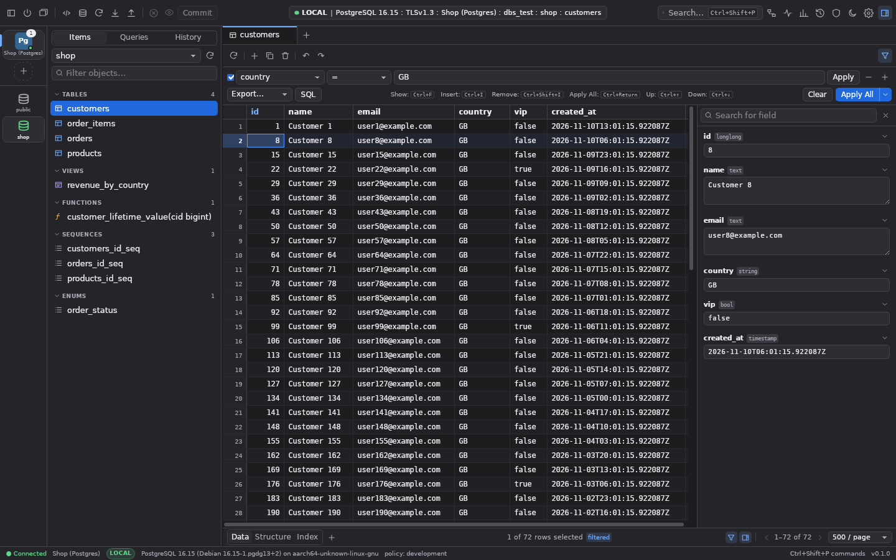
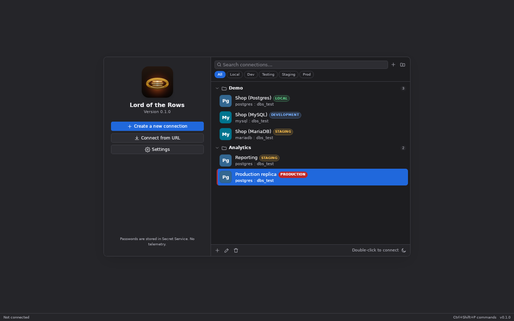
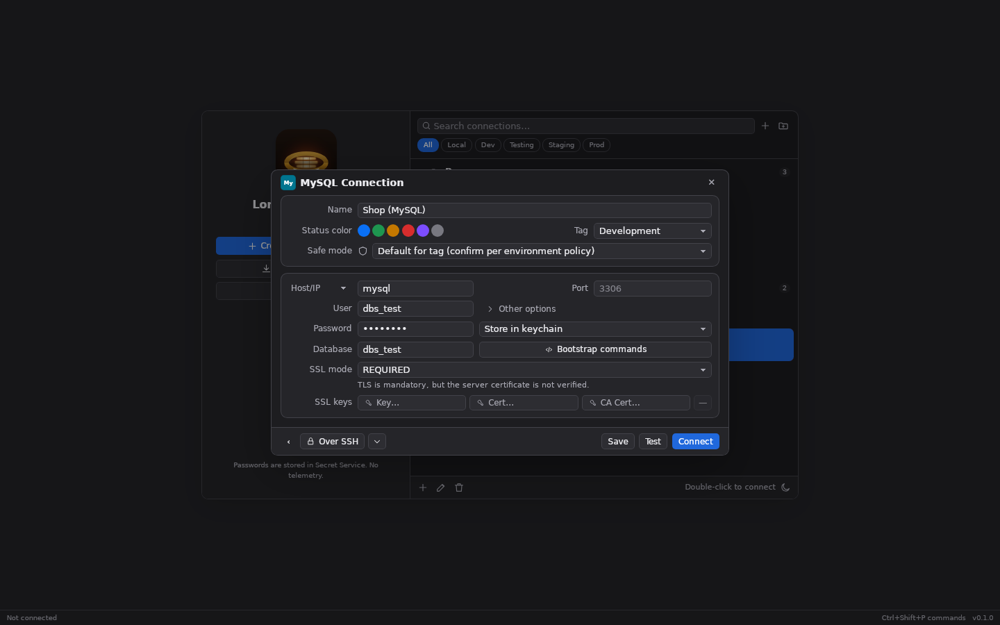
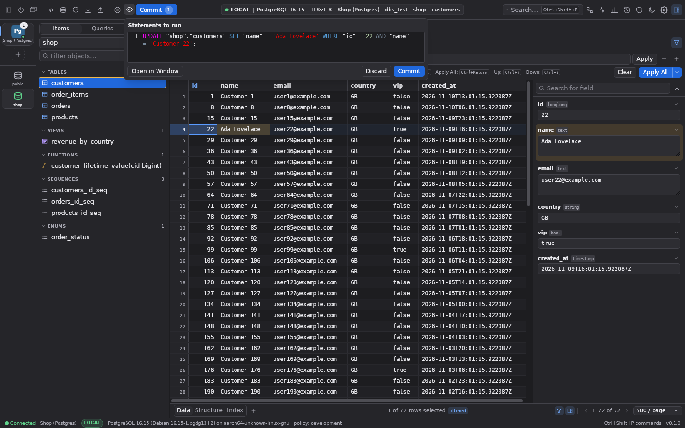
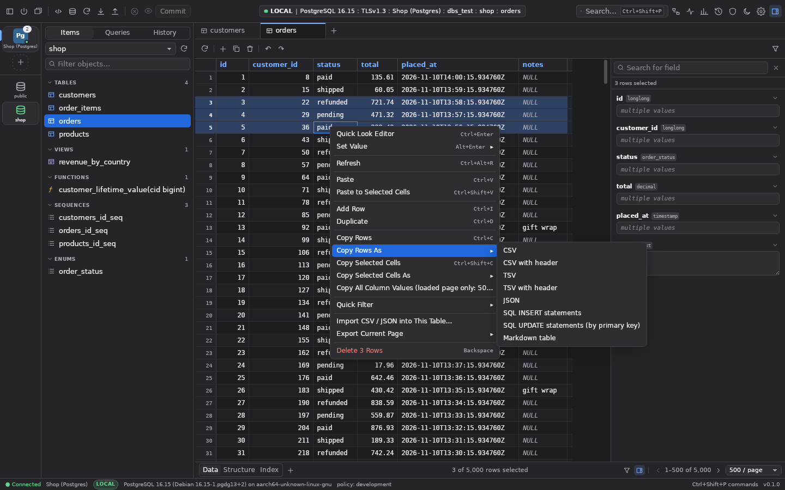
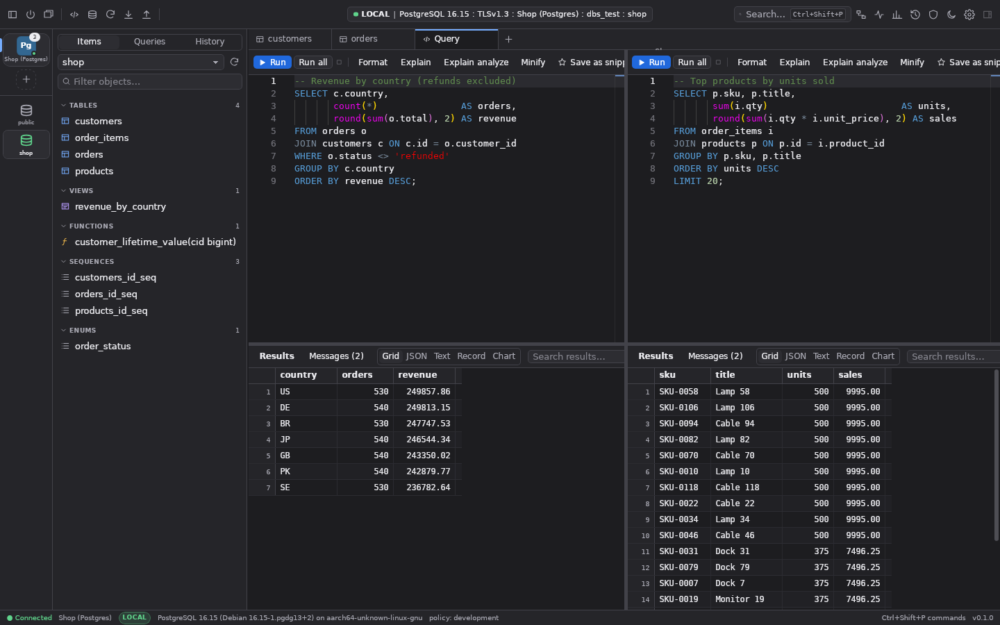
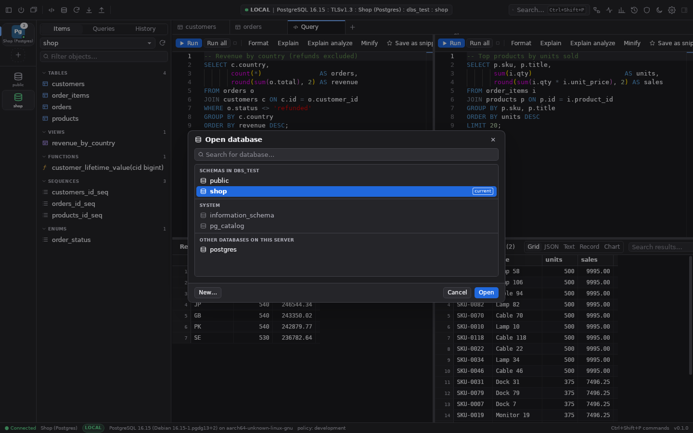
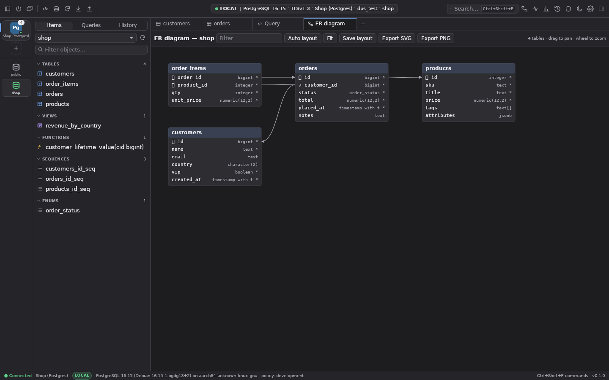
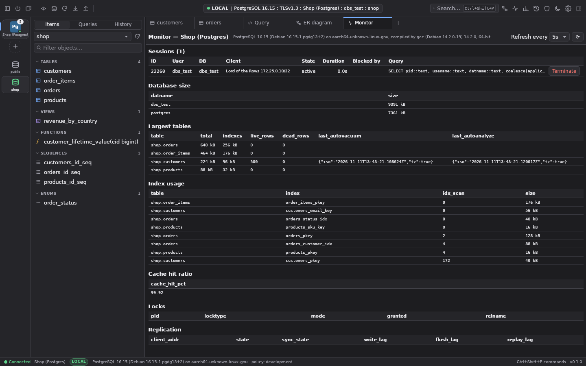
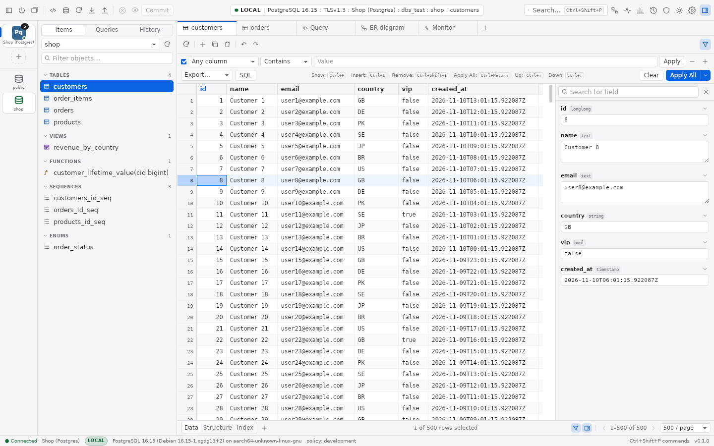

# Lord of the Rows

**Lord of the Rows** is DigitalTolk's own desktop database client, designed and built in-house
from scratch with Tauri 2 (Rust backend) and React/TypeScript. All code, design and artwork are original.



**Status:** macOS builds are signed with DigitalTolk's Developer ID and notarized by Apple
(universal: Apple Silicon + Intel; `scripts/release-macos.sh`). Tested end to end on Linux in Docker
against real PostgreSQL, MySQL, MariaDB, Redis, DynamoDB Local and an SSH bastion. Windows builds
are not done yet; see [FEATURE_MATRIX.md](FEATURE_MATRIX.md), [BLOCKERS.md](BLOCKERS.md).

## Install (macOS)

```
brew trust DigitalTolk/tools
brew install --cask DigitalTolk/tools/lord-of-the-rows
```

Or download the DMG from [Releases](https://github.com/DigitalTolk/Lord-of-Rows/releases). Builds are universal
(Apple Silicon + Intel, macOS 11+), signed with DigitalTolk's Developer ID and notarized by Apple.
Update with `brew update && brew upgrade --cask DigitalTolk/tools/lord-of-the-rows`.

## What works today

- PostgreSQL, MySQL, SQLite, Redis, DynamoDB (PartiQL; tested against DynamoDB Local) (plus wire-compatible engines, unverified)
- Connection launcher, engine picker, connection rail with per-database tabs
- SSH tunnels (password / key / passphrase / agent, jump hosts, strict host-key checks)
- SSL modes PREFERRED / DISABLED / REQUIRED / VERIFY-CA / VERIFY-IDENTITY (custom CA, client certs); plaintext-capable modes refused for remote production
- SQL editor (Monaco) with schema-aware completion; grid / JSON / text / record / chart results
- Inline editing with SQL review, single-transaction commit and conflict detection
- Structure view, table designer, schema diff → migrations (reversibility-aware)
- ER diagram, monitoring, dashboards, command palette, themes
- Production safe mode enforced in Rust; tamper-evident audit log; passwords in the OS keychain
- Optional AI assistant (off by default; prompt preview + explicit send; see [docs/AI_ASSISTANT.md](docs/AI_ASSISTANT.md))

## Screenshots

All screenshots are taken from the real app (Linux build, driven over WebDriver by
`e2e/debug/screenshots.test.mjs`) against the demo fixtures in `tests/fixtures/`.

**Connection launcher**: connection groups, environment pills and the environment filter chips.



**New connection**: the MySQL form with tag, safe mode and SSL mode.



**Table workspace**: filter bar, row detail panel, status pill, schema rail and the Items sidebar.


**Pending changes**: a staged cell edit (highlighted) and the preview of the exact UPDATE that Commit will run.



**Grid context menu**: copy, set value, quick filter, delete, with the *Copy Rows As* submenu open.



**Split SQL editor**: two queries side by side, each with its own results.



**Open database** (Ctrl/⌘+K): schemas in the current database, system schemas and other databases on the server.



**ER diagram** of the demo `shop` schema.



**Monitor**: live sessions, database and table sizes, index usage, cache hit ratio.



**Light theme**



## Layout

```
crates/dbs-core      types, driver trait, dialect quoting, parameterised SQL builders
crates/dbs-drivers   postgres, mysql, sqlite, redis, dynamodb
crates/dbs-safety    SQL lexer/classifier, safety policy, confirmation tokens
crates/dbs-audit     hash-chained audit log
crates/dbs-store     local app metadata (SQLite)
crates/dbs-secrets   OS keychain
crates/dbs-ssh       SSH tunnels
crates/dbs-io        import/export
crates/dbs-schema    schema diff, migrations, designer DDL
crates/dbs-ai        optional AI assistant: prompt builders, redaction, provider clients
src-tauri/           desktop shell + IPC commands
frontend/            React UI
e2e/                 WebDriver end-to-end tests (real app + real databases)
```

## Develop (Docker only; no local Rust/Node needed)

```sh
docker compose build dev
docker compose up -d postgres mysql redis sshd dynamodb
docker compose run --rm dev cargo test --workspace          # Rust unit + integration
docker compose run --rm -w /work/frontend dev npx vitest run # frontend unit
docker compose run --rm dev sh -c 'cd frontend && npx vite build && cd .. && cargo build -p dbstudio --features custom-protocol && e2e/run.sh'
docker compose up -d desktop   # preview the Linux build: http://localhost:6080/vnc.html?autoconnect=1&resize=scale
```

Test credentials (throwaway, local containers only): Postgres/MySQL `dbs_test`/`dbs_test` db `dbs_test`
(hosts `postgres`, `mysql`), Redis `redis:6379`, SSH bastion `sshd` user `tunnel`/`tunnelpw`,
DynamoDB Local endpoint `http://dynamodb:8000` (host: `http://127.0.0.1:58000`), region `us-east-1`, any alphanumeric
access key ID (e.g. `dbstest`) with any secret.

See [TEST_RESULTS.md](TEST_RESULTS.md), [SECURITY_FINDINGS.md](SECURITY_FINDINGS.md).
